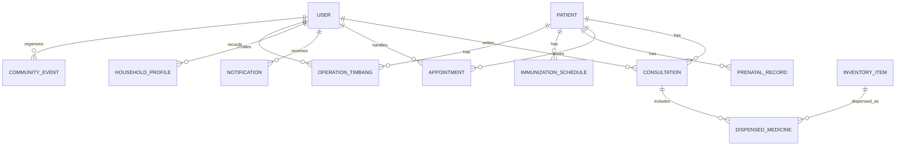

# BHCMS Database and Full Stack Demonstration Guide

## 1. Database Connection (What to show first)

### Application configuration
- Active DB URI is configured in `config.py:13`:
```python
SQLALCHEMY_DATABASE_URI = 'mysql+pymysql://root:@127.0.0.1:3307/bhcms_db'
```
- Flask loads the config and binds SQLAlchemy in `app.py:22` and `app.py:244`:
```python
app.config.from_object(Config)
app.config['SQLALCHEMY_DATABASE_URI'] = Config.SQLALCHEMY_DATABASE_URI
db.init_app(app)
```
- Tables are created at startup in `app.py:270`:
```python
db.create_all()
```

### Quick connection proof in terminal
Run these while presenting:
```powershell
Set-Location "c:\Users\Personal\Downloads\PROTOTYPE BHCMS (1)\PROTOTYPE BHCMS"
mysql -h 127.0.0.1 -P 3307 -u root -e "SHOW DATABASES;"
mysql -h 127.0.0.1 -P 3307 -u root -D bhcms_db -e "SHOW TABLES;"
```

## 2. Database Design (Tables and relationships)

### Core tables
- `user`: authentication and roles (`Admin`, `Midwife`, `BHW`) in `models.py:23`
- `patient`: patient master records in `models.py:43`
- `consultation`: clinical records linked to patient and health worker in `models.py:70`
- `dispensed_medicine`: medicines dispensed per consultation in `models.py:122`
- `inventory_item`: medicine/supply stock in `models.py:95`
- `appointment`: scheduling records in `models.py:435`
- `prenatal_record`: maternal tracking in `models.py:236`
- `immunization_schedule`: immunization tracking in `models.py:277`
- `operation_timbang`: child nutrition and BMI in `models.py:164`
- `household_profile`: BHW household profiling in `models.py:142`
- `notification`: alerts and reminders in `models.py:327`
- `community_event`: community activity records in `models.py:470`

### Relationship map (ERD)


### Indexes and performance design
- Composite indexes are defined in models and reinforced at startup in `app.py:176` (`ensure_performance_indexes`).
- Example indexes:
  - `ix_consultation_patient_date`
  - `ix_appointment_worker_date_time_status`
  - `ix_immunization_completed_scheduled`
  - `ix_notification_user_read_created`

## 3. Important Queries to Explain

### Dashboard aggregate query
In `routes/core.py:39`, patient distribution is grouped by zone:
```python
purok_distribution = db.session.query(
    Patient.purok,
    func.count(Patient.id).label('count')
).group_by(Patient.purok).all()
```

SQL equivalent:
```sql
SELECT purok, COUNT(id) AS count
FROM patient
GROUP BY purok;
```

### Patient history query (retrieval)
In `routes/patients.py:171`:
```python
consultations = Consultation.query.filter_by(patient_id=patient_id)\
    .order_by(Consultation.date.desc()).all()
```

SQL equivalent:
```sql
SELECT *
FROM consultation
WHERE patient_id = ?
ORDER BY date DESC;
```

### Appointment conflict query (business rule)
In `models.py:451` (`Appointment.check_conflict`):
- Filters by same worker, date, status, and time window.
- Prevents double booking.

### Inventory to consultation transaction
In `routes/consultations.py:58` onward:
1. Insert consultation
2. Insert dispensed medicines
3. Decrement inventory quantity
4. `db.session.commit()`

This is a complete write transaction from one form submission.

## 4. Full Front-End to Back-End Demonstration Script

Use this exact sequence in your defense/demo.

### Demo A: Add patient and prove DB write
1. In UI, open `Patients` and submit Add Patient form (`templates/patients.html:142`).
2. Backend route handles POST at `routes/patients.py:30` (`patients()`): validates input, `db.session.add(new_patient)`, then `db.session.commit()`.
3. In DB terminal, run:
```sql
SELECT id, full_name, gender, purok, created_at
FROM patient
ORDER BY id DESC
LIMIT 5;
```
4. Explain: the new row appears immediately, confirming front-end to DB write.

### Demo B: Retrieve data through API (UI to server to DB to UI)
1. In Patients UI, open a patient history modal/button (uses JS `fetch` in `templates/patients.html:460`).
2. API endpoint hit: `/api/patient/<id>/history` in `routes/patients.py:168`.
3. Backend executes consultation query and returns JSON.
4. In browser DevTools Network tab, show JSON response payload.

### Demo C: Book appointment and show relationship integrity
1. In UI, open `Appointments` and submit booking form (`templates/appointments.html:183`).
2. Backend route `routes/appointments.py:115`:
- Looks up/creates patient
- Resolves worker
- Calls `Appointment.check_conflict`
- Inserts appointment + notifications
- Commits transaction
3. Verify in DB:
```sql
SELECT a.id, p.full_name AS patient, u.full_name AS worker,
       a.appointment_date, a.appointment_time, a.status
FROM appointment a
JOIN patient p ON p.id = a.patient_id
JOIN user u ON u.id = a.health_worker_id
ORDER BY a.id DESC
LIMIT 5;
```

### Demo D: Add consultation and show inventory update
1. In UI, open patient then Add Consultation (`templates/add_consultation.html:11`).
2. Submit diagnosis and at least one medicine line (`medicine_id[]`).
3. Backend in `routes/consultations.py:32` creates consultation and dispensed medicine rows, then decreases `inventory_item.quantity`.
4. Verify in DB:
```sql
SELECT id, patient_id, consultation_type, date
FROM consultation
ORDER BY id DESC
LIMIT 5;

SELECT id, consultation_id, inventory_item_id, quantity_dispensed
FROM dispensed_medicine
ORDER BY id DESC
LIMIT 5;

SELECT id, name, quantity
FROM inventory_item
ORDER BY id DESC
LIMIT 10;
```

### Demo E: Dashboard read path (aggregates and alerts)
1. Open Dashboard (`/`) in UI.
2. Backend route `routes/core.py:33` calculates counts, low stock, grouped purok data, and unread notifications.
3. Explain this is retrieval-only flow from DB to template rendering.

## 5. Proof that data is stored and retrieved properly

### Automated test proof
Use these tests (already in repo):
- `tests/test_routes_patients.py:6` checks patient insertion
- `tests/test_routes_consultations.py:4` checks consultation insert then history retrieval
- `tests/test_routes_appointments.py:6` checks appointment booking
- `tests/test_routes_core.py:1` checks dashboard/notification retrieval endpoints

Run:
```powershell
Set-Location "c:\Users\Personal\Downloads\PROTOTYPE BHCMS (1)\PROTOTYPE BHCMS"
.\.venv\Scripts\python.exe -m pytest tests/test_routes_patients.py tests/test_routes_consultations.py tests/test_routes_appointments.py tests/test_routes_core.py -q
```

### Optional live DB sanity checks
```sql
SELECT COUNT(*) AS patients FROM patient;
SELECT COUNT(*) AS consultations FROM consultation;
SELECT COUNT(*) AS appointments FROM appointment;
SELECT COUNT(*) AS notifications FROM notification;
```

## 6. Suggested speaking flow (short)
1. "This is the UI where users input data."
2. "This route receives the request, validates it, and commits to MySQL through SQLAlchemy."
3. "These tables are linked by foreign keys to keep data consistent."
4. "Here is the exact SQL output showing the new records."
5. "When we load the dashboard/API, data is retrieved with aggregate and filtered queries."
6. "Automated tests confirm write and read behavior across major modules."
